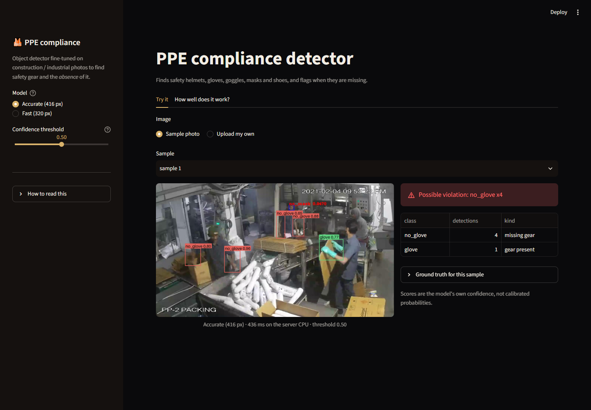
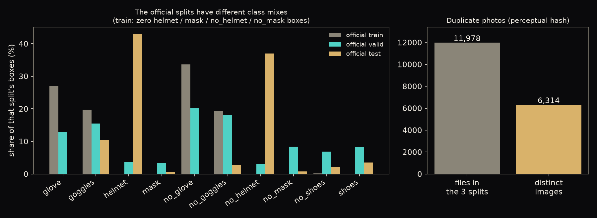
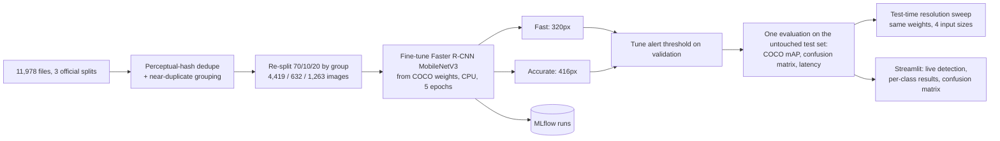
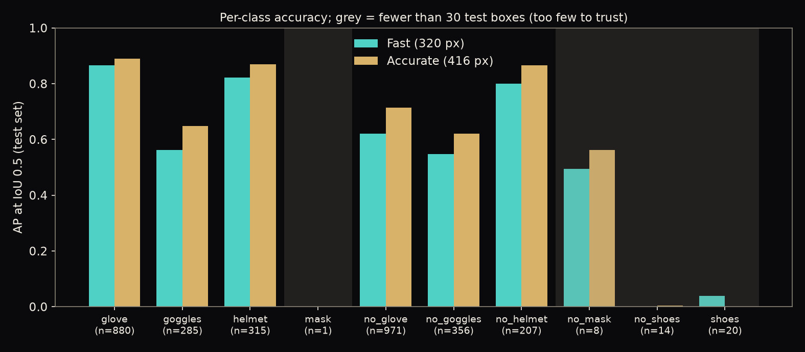
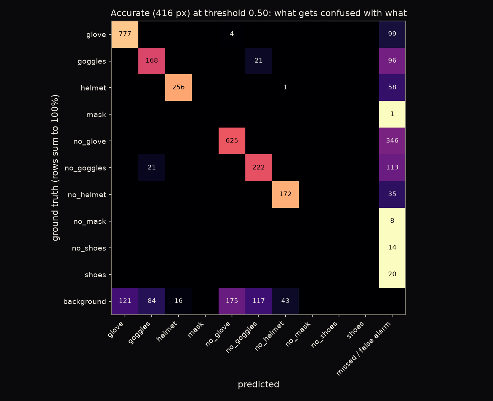
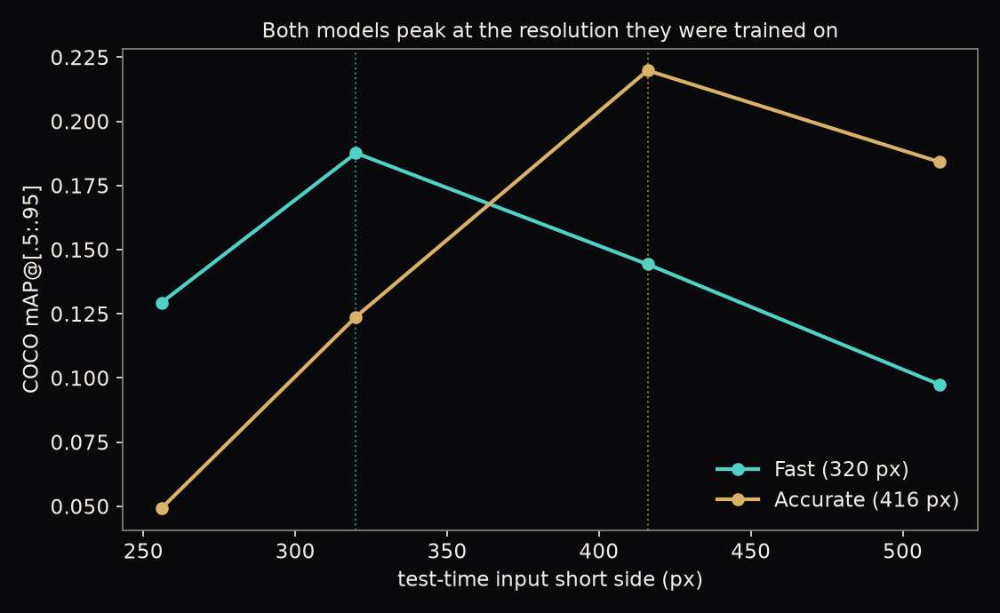
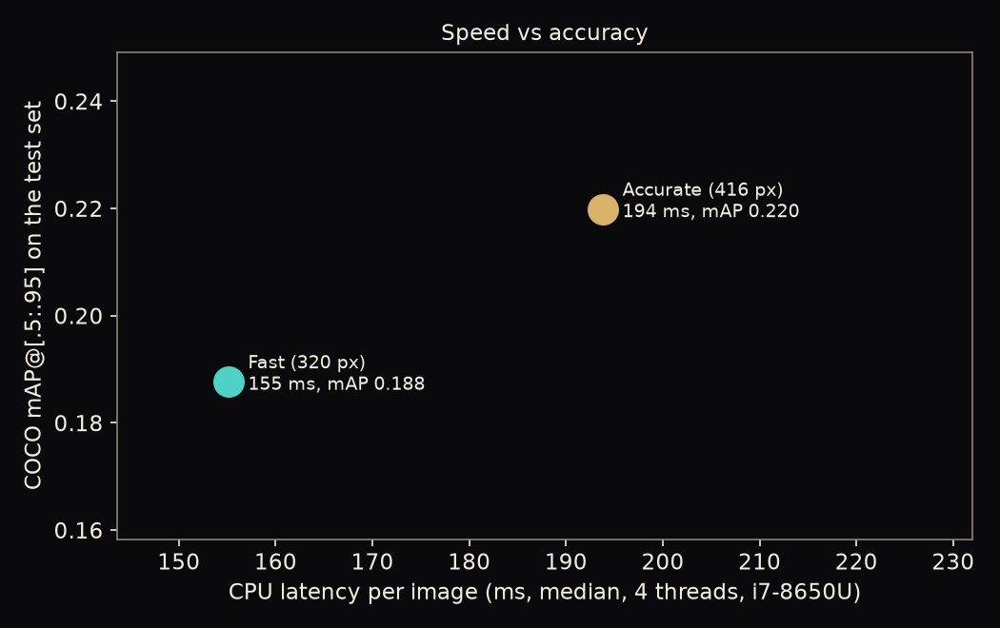
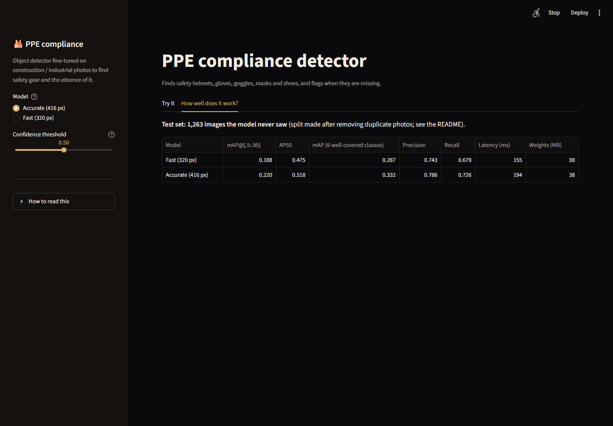

# PPE Compliance Detection: Object Detection for Safety Gear, and Its Absence

Finds safety helmets, gloves, goggles, masks and shoes in real construction/industrial photos — and, just as
importantly, detects when they are **missing**. Two Faster R-CNN detectors (MobileNetV3 backbone) fine-tuned
from COCO weights entirely on **CPU**, at two input resolutions, compared honestly on a held-out test set the
models never saw. The interesting part of this project turned out to be upstream of any model: the official
dataset splits were unusable as shipped, and fixing that came first.

**Live demo:** https://ppe-safety-detection-2s5rwah5e9zprhxazlwkty.streamlit.app/ · **Stack:** PyTorch/torchvision (Faster R-CNN, MobileNetV3), pycocotools, MLflow, Streamlit + Plotly



## 1. Business problem

| | |
|---|---|
| **Stakeholder** | A site-safety officer reviewing camera footage or spot-check photos |
| **Decision** | Which photos need a human look because gear appears to be missing? |
| **The tension** | Missing a real violation risks an injury; flagging too many false alarms trains the reviewer to ignore the tool. Ten classes, wildly imbalanced (some have thousands of boxes, some have single digits) |
| **KPIs** | **COCO mAP / AP50** overall and per-class; **precision/recall/F1** at a tuned confidence threshold; **CPU latency** (this runs on ordinary hardware, no GPU); image-level "any violation?" detection quality |

## 2. Data

The **PPEs dataset** (Roboflow Universe, "Personal Protective Equipment", CC BY 4.0), mirrored on Hugging Face
by `keremberke/protective-equipment-detection`: real construction/industrial site photos, COCO-format boxes,
10 classes — 5 gear-present (`glove`, `goggles`, `helmet`, `mask`, `shoes`) and their 5 "missing" counterparts
(`no_glove`, `no_goggles`, `no_helmet`, `no_mask`, `no_shoes`). Public, no login.

### The data problem that had to be fixed first



The dataset ships as three pre-made splits (train/valid/test), and they are **not usable as-is**:

- The official **train** split has **zero** `helmet`, `mask`, `no_helmet` or `no_mask` boxes — every example
  of those classes lives in valid/test.
- The 11,978 files across the three splits reduce to only **6,314 distinct images** by perceptual hash
  (dHash): hundreds of near-identical consecutive video frames were scattered across train/valid/test, which
  would let a model memorise a frame it had already half-seen rather than learn to detect.

**Fix**, in `data.make_splits()`: pool all three official splits, drop exact-duplicate photos, group
near-duplicates (Hamming distance <= 1 on a 64-bit hash, so a burst of near-identical frames stays together),
then re-split 70/10/20 by whole group, largest groups first. Result: 4,419 train / 632 validation / 1,263 test
images with every class represented in every split, and no leakage of near-duplicate frames across the
train/test boundary.

## 3. Architecture



Both models are trained on a **1,600-image, class-frequency-weighted subsample** of the 4,419-image train
split (rarer classes over-sampled so they survive the cut) for a bounded CPU training time (~13-20 min/epoch
on a laptop, 5 epochs each). The score threshold is tuned on 332 held-out validation images (never used for
early stopping) by maximising micro-F1, then applied once to the untouched 1,263-image test set.

## 4. Results (held-out test set, 1,263 images)

| Model | mAP@[.5:.95] | AP50 | **mAP, 6 well-covered classes** | Precision | Recall | F1 | Latency (median) | Weights |
|---|---|---|---|---|---|---|---|---|
| Fast (320px) | 0.188 | 0.475 | 0.287 | 74.3% | 67.9% | 0.710 | 155 ms | 38 MB |
| **Accurate (416px)** | **0.220** | **0.518** | **0.332** | **78.6%** | **72.6%** | **0.755** | 194 ms | 38 MB |



**Honest read.** Only 6 of 10 classes have >= 30 test boxes, enough to trust an AP number; on those the
accurate model reaches **AP50 0.768**. The other 4 (`mask`, `no_mask`, `no_shoes`, `shoes`, shown grey and
excluded from the headline "6 well-covered classes" figure) have 1-20 test boxes each — a direct, unfixable-
by-more-training consequence of the class imbalance documented above. `mask` has exactly **one** test box.

### Where the accurate model actually goes wrong



Most detections land on the diagonal. The two largest cross-class confusions are **goggles predicted as
no_helmet** (21 cases) and **no_glove predicted as no_goggles** (21 cases) — both consistent with the model
keying on co-occurring image context (a face region, a hand region) rather than gear-specific texture. The
single biggest error mode overall is missed detections and false alarms on **`no_glove`**, simply because it
is the largest class in the data (most opportunities for both kinds of error).

### Does test-time resolution matter?



Yes, sharply — each model, same trained weights, tested at 4 input sizes with no retraining. **Both peak
almost exactly at the resolution they were fine-tuned on** and degrade in both directions (the fast model
drops from 0.188 to 0.098 mAP at 512px; the accurate model drops from 0.220 to 0.049 at 256px). "Just run it
bigger at test time for free accuracy" does not work for a small detector tuned to one scale.



The accurate model costs **+25% latency** for **+17% mAP** and **+9% AP50** — a real but modest trade a
deployer could reasonably make either way, depending on whether the bottleneck is a live feed (favour fast)
or a batch review queue (favour accurate).

## 5. The app

`app/streamlit_app.py`, two tabs:

- **Try it**: pick a sample photo or upload your own, choose fast/accurate and a confidence threshold, see
  boxes drawn live (green = gear present, red = gear missing) with a violation summary and the sample's
  ground truth for comparison.
- **How well does it work?**: the results table above and per-class AP50 for the selected model.

| Try it: live detection | Results |
|---|---|
|  |  |

## 6. Limitations

- **Severe class imbalance** the re-split cannot fix, only make honest: 4 of 10 classes have too few test
  examples (1-20 boxes) to report a trustworthy AP.
- **5 training epochs, a 1,600-image subsample.** Validation AP50 was still rising at epoch 5 for both models
  (see the notebook) — more data and more epochs would very likely help further; this was a CPU time budget,
  not a plateau.
- **CPU-only, no GPU available on this machine.** Latency numbers are for a 4-thread i7-8650U; a GPU
  deployment would be far faster and could afford the accurate model's larger input size at no real cost.
- **Resolution is not swappable at inference time** without retraining — see the size-sweep finding.
- **`mask` has exactly one test box**; its AP is not meaningful and should not be quoted anywhere.
- **A screening aid, not a safety system.** It misses real violations and raises false alarms (see precision/
  recall above); a human must review flagged images before any action is taken.

## 7. Run it

```bash
uv sync --all-groups
uv run python -m ppedet.train fast --epochs 5       # downloads the data (~1 GB), fine-tunes (~13 min/epoch)
uv run python -m ppedet.train accurate --epochs 5    # ~15-20 min/epoch; both resumable (checkpoints every epoch)
uv run python -m ppedet.run_eval fast accurate       # test-set metrics, confusion matrix, size sweep
uv run python -m ppedet.report                       # figures
uv run streamlit run app/streamlit_app.py
uv run pytest -q && uv run ruff check .
```

Every training run and test metric is logged to MLflow (`mlflow.db`, experiment `ppedet`):
`python -m mlflow ui --backend-store-uri sqlite:///mlflow.db`.

```
src/ppedet/   config, data (download, dedupe, resplit), model, evaluate (COCO metrics, confusion, latency),
              train (resumable), run_eval, report
app/          Streamlit app
assets/       6 sample photos + ground truth, for the deployed app (dataset licence forbids redistributing more)
artifacts/    fast.pt, accurate.pt (fp16, ~38 MB each), results.json
notebooks/    01_ppe_analysis.ipynb (executed)
tests/        11 offline tests on synthetic data
```

**Deploy:** Streamlit Community Cloud (main file `app/streamlit_app.py`; CPU-only PyTorch wheels) or the
included `Dockerfile`. CI runs ruff and pytest on every push.

## Attribution and license

Code: MIT (`LICENSE`). Data: "PPEs" dataset, Roboflow Universe, **CC BY 4.0** — please attribute the original
dataset per the licence when reusing. Mirror used: `keremberke/protective-equipment-detection` on Hugging
Face. The full dataset is downloaded on demand and not redistributed; only 6 sample images (with the licence's
required attribution honoured via this README) are committed for the deployed demo.
